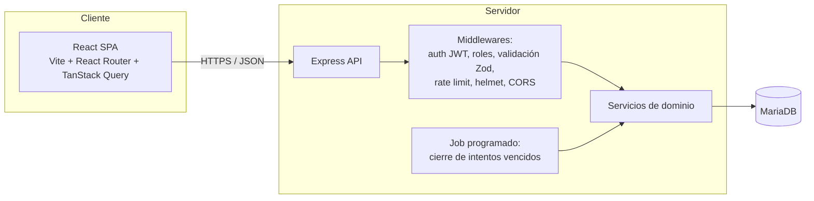

# Documento de Diseño: Plataforma de Exámenes en Línea

## Visión general

Aplicación web de tres capas: SPA en React, API REST en Node.js/Express y base de datos MariaDB. La autenticación usa JWT (access token corto + refresh token rotativo en cookie `httpOnly`). El servidor es la única fuente de verdad para tiempo, calificación y revelado de respuestas.

**Decisión de diseño central:** el modo `examen` y el modo `practica` son dos tipos de intento con reglas de seguridad opuestas. El modo se fija al crear el intento y se valida siempre en el servidor.

## Arquitectura



### Estructura del repositorio (monorepo)

```
/
├── backend/
│   ├── src/
│   │   ├── config/          # env, db, jwt
│   │   ├── middlewares/     # auth, roles, validate, errorHandler, rateLimit
│   │   ├── modules/
│   │   │   ├── auth/
│   │   │   ├── usuarios/
│   │   │   ├── cursos/
│   │   │   ├── preguntas/
│   │   │   ├── examenes/
│   │   │   ├── intentos/    # examen + práctica
│   │   │   ├── calificacion/
│   │   │   └── reportes/
│   │   ├── jobs/            # cierre de intentos vencidos
│   │   ├── utils/
│   │   └── app.ts / server.ts
│   ├── prisma/ (o migrations/)
│   └── tests/
└── frontend/
    └── src/
        ├── api/             # cliente HTTP + hooks TanStack Query
        ├── auth/            # contexto, rutas protegidas
        ├── features/
        │   ├── auth/
        │   ├── cursos/
        │   ├── preguntas/
        │   ├── examenes/
        │   ├── presentar-examen/
        │   ├── practica/
        │   └── resultados/
        ├── components/
        └── routes/
```

**Tecnologías:** TypeScript, Express, `mysql2` + Prisma (provider `mysql`, compatible con MariaDB 10.6+), Zod, `argon2`, `jsonwebtoken`, `helmet`, `express-rate-limit`, `node-cron`, Vitest/Jest + Supertest, React Testing Library, Playwright (E2E).

## Modelo de datos (MariaDB)

```sql
CREATE TABLE usuarios (
  id            BIGINT UNSIGNED AUTO_INCREMENT PRIMARY KEY,
  nombre        VARCHAR(120) NOT NULL,
  email         VARCHAR(190) NOT NULL UNIQUE,
  password_hash VARCHAR(255) NOT NULL,
  rol           ENUM('admin','profesor','estudiante') NOT NULL,
  activo        TINYINT(1) NOT NULL DEFAULT 1,
  creado_en     DATETIME NOT NULL DEFAULT CURRENT_TIMESTAMP
);

CREATE TABLE refresh_tokens (
  id          BIGINT UNSIGNED AUTO_INCREMENT PRIMARY KEY,
  usuario_id  BIGINT UNSIGNED NOT NULL,
  token_hash  CHAR(64) NOT NULL UNIQUE,
  expira_en   DATETIME NOT NULL,
  revocado    TINYINT(1) NOT NULL DEFAULT 0,
  FOREIGN KEY (usuario_id) REFERENCES usuarios(id) ON DELETE CASCADE
);

CREATE TABLE cursos (
  id           BIGINT UNSIGNED AUTO_INCREMENT PRIMARY KEY,
  nombre       VARCHAR(150) NOT NULL,
  profesor_id  BIGINT UNSIGNED NOT NULL,
  FOREIGN KEY (profesor_id) REFERENCES usuarios(id)
);

CREATE TABLE inscripciones (
  curso_id      BIGINT UNSIGNED NOT NULL,
  estudiante_id BIGINT UNSIGNED NOT NULL,
  PRIMARY KEY (curso_id, estudiante_id),
  FOREIGN KEY (curso_id) REFERENCES cursos(id) ON DELETE CASCADE,
  FOREIGN KEY (estudiante_id) REFERENCES usuarios(id) ON DELETE CASCADE
);

CREATE TABLE preguntas (
  id           BIGINT UNSIGNED AUTO_INCREMENT PRIMARY KEY,
  curso_id     BIGINT UNSIGNED NOT NULL,
  autor_id     BIGINT UNSIGNED NOT NULL,
  tipo         ENUM('opcion_multiple','seleccion_multiple','verdadero_falso','abierta') NOT NULL,
  enunciado    TEXT NOT NULL,
  puntaje      DECIMAL(6,2) NOT NULL DEFAULT 1,
  explicacion  TEXT NULL,               -- explicación general (modo práctica)
  respuesta_modelo TEXT NULL,           -- para preguntas abiertas
  version      INT NOT NULL DEFAULT 1,
  tema         VARCHAR(100) NULL,
  FOREIGN KEY (curso_id) REFERENCES cursos(id),
  FOREIGN KEY (autor_id) REFERENCES usuarios(id)
);

CREATE TABLE opciones (
  id           BIGINT UNSIGNED AUTO_INCREMENT PRIMARY KEY,
  pregunta_id  BIGINT UNSIGNED NOT NULL,
  texto        TEXT NOT NULL,
  es_correcta  TINYINT(1) NOT NULL DEFAULT 0,
  explicacion  TEXT NULL,               -- por qué es correcta/incorrecta
  orden        INT NOT NULL DEFAULT 0,
  FOREIGN KEY (pregunta_id) REFERENCES preguntas(id) ON DELETE CASCADE
);

CREATE TABLE examenes (
  id                BIGINT UNSIGNED AUTO_INCREMENT PRIMARY KEY,
  curso_id          BIGINT UNSIGNED NOT NULL,
  titulo            VARCHAR(200) NOT NULL,
  instrucciones     TEXT NULL,
  duracion_min      INT NOT NULL,
  fecha_inicio      DATETIME NOT NULL,
  fecha_fin         DATETIME NOT NULL,
  intentos_max      INT NOT NULL DEFAULT 1,
  aleatorizar       TINYINT(1) NOT NULL DEFAULT 0,
  permite_practica  TINYINT(1) NOT NULL DEFAULT 0,
  mostrar_resultados ENUM('nunca','al_entregar','al_cerrar_examen') NOT NULL DEFAULT 'al_entregar',
  estado            ENUM('borrador','publicado','cerrado') NOT NULL DEFAULT 'borrador',
  FOREIGN KEY (curso_id) REFERENCES cursos(id)
);

CREATE TABLE examen_preguntas (
  examen_id    BIGINT UNSIGNED NOT NULL,
  pregunta_id  BIGINT UNSIGNED NOT NULL,
  orden        INT NOT NULL,
  puntaje      DECIMAL(6,2) NULL,       -- override opcional
  PRIMARY KEY (examen_id, pregunta_id),
  FOREIGN KEY (examen_id) REFERENCES examenes(id) ON DELETE CASCADE,
  FOREIGN KEY (pregunta_id) REFERENCES preguntas(id)
);

CREATE TABLE intentos (
  id             BIGINT UNSIGNED AUTO_INCREMENT PRIMARY KEY,
  examen_id      BIGINT UNSIGNED NOT NULL,
  estudiante_id  BIGINT UNSIGNED NOT NULL,
  modo           ENUM('examen','practica') NOT NULL,
  estado         ENUM('en_curso','entregado','pendiente_revision','calificado') NOT NULL DEFAULT 'en_curso',
  inicio         DATETIME NOT NULL,
  fin_limite     DATETIME NULL,         -- NULL en práctica sin límite
  entregado_en   DATETIME NULL,
  calificacion   DECIMAL(6,2) NULL,
  orden_semilla  INT NOT NULL,          -- reproduce aleatorización
  ip             VARCHAR(45) NULL,
  user_agent     VARCHAR(255) NULL,
  FOREIGN KEY (examen_id) REFERENCES examenes(id),
  FOREIGN KEY (estudiante_id) REFERENCES usuarios(id),
  INDEX idx_intentos_examen_est (examen_id, estudiante_id, modo),
  INDEX idx_intentos_vencimiento (estado, fin_limite)
);

CREATE TABLE intento_preguntas (        -- snapshot inmutable por intento
  intento_id   BIGINT UNSIGNED NOT NULL,
  pregunta_id  BIGINT UNSIGNED NOT NULL,
  version      INT NOT NULL,
  orden        INT NOT NULL,
  PRIMARY KEY (intento_id, pregunta_id),
  FOREIGN KEY (intento_id) REFERENCES intentos(id) ON DELETE CASCADE
);

CREATE TABLE respuestas (
  intento_id       BIGINT UNSIGNED NOT NULL,
  pregunta_id      BIGINT UNSIGNED NOT NULL,
  opciones_elegidas JSON NULL,          -- array de ids de opciones
  texto            TEXT NULL,
  es_correcta      TINYINT(1) NULL,
  puntaje_obtenido DECIMAL(6,2) NULL,
  comentario_profesor TEXT NULL,
  actualizado_en   DATETIME NOT NULL DEFAULT CURRENT_TIMESTAMP ON UPDATE CURRENT_TIMESTAMP,
  PRIMARY KEY (intento_id, pregunta_id),
  FOREIGN KEY (intento_id) REFERENCES intentos(id) ON DELETE CASCADE
);

CREATE TABLE eventos_integridad (
  id          BIGINT UNSIGNED AUTO_INCREMENT PRIMARY KEY,
  intento_id  BIGINT UNSIGNED NOT NULL,
  tipo        ENUM('perdida_foco','cambio_pestana','salida_pantalla_completa','pegado') NOT NULL,
  ocurrido_en DATETIME NOT NULL DEFAULT CURRENT_TIMESTAMP,
  FOREIGN KEY (intento_id) REFERENCES intentos(id) ON DELETE CASCADE
);

CREATE TABLE auditoria (
  id          BIGINT UNSIGNED AUTO_INCREMENT PRIMARY KEY,
  usuario_id  BIGINT UNSIGNED NULL,
  accion      VARCHAR(100) NOT NULL,
  detalle     JSON NULL,
  creado_en   DATETIME NOT NULL DEFAULT CURRENT_TIMESTAMP
);
```

> Para el versionado (Requisito 4.4), al editar una pregunta ya usada en intentos finalizados se incrementa `version` y se conserva el contenido anterior en una tabla `preguntas_historial` (o se crea una nueva fila enlazada). `intento_preguntas.version` fija qué versión vio cada estudiante.

## API REST

Prefijo `/api/v1`. Todas las respuestas en JSON. Errores con formato `{ error: { codigo, mensaje, detalles? } }`.

### Autenticación
| Método | Ruta | Rol | Descripción |
|---|---|---|---|
| POST | `/auth/login` | público | Devuelve access token y setea refresh cookie |
| POST | `/auth/refresh` | público | Rota refresh token y emite nuevo access token |
| POST | `/auth/logout` | autenticado | Revoca refresh token |
| GET | `/auth/me` | autenticado | Perfil del usuario actual |

### Usuarios, cursos
| Método | Ruta | Rol |
|---|---|---|
| CRUD | `/usuarios` | admin |
| CRUD | `/cursos` | admin, profesor |
| POST/DELETE | `/cursos/:id/inscripciones` | admin, profesor |
| GET | `/mis-cursos` | estudiante, profesor |

### Banco de preguntas y exámenes
| Método | Ruta | Rol |
|---|---|---|
| CRUD | `/preguntas` | profesor |
| CRUD | `/examenes` | profesor |
| PUT | `/examenes/:id/preguntas` | profesor |
| POST | `/examenes/:id/publicar` | profesor |
| GET | `/examenes/disponibles` | estudiante |

### Intentos (examen y práctica)
| Método | Ruta | Rol | Descripción |
|---|---|---|---|
| POST | `/examenes/:id/intentos` | estudiante | Body `{ modo: 'examen' \| 'practica', soloFalladas?: boolean }` |
| GET | `/intentos/:id` | estudiante (dueño) | Estado, preguntas (sin `es_correcta`), tiempo restante |
| PUT | `/intentos/:id/respuestas` | estudiante (dueño) | Autoguardado idempotente |
| POST | `/intentos/:id/entregar` | estudiante (dueño) | Cierra y califica |
| POST | `/intentos/:id/eventos` | estudiante (dueño) | Registra evento de integridad |
| **POST** | **`/intentos/:id/preguntas/:preguntaId/responder`** | estudiante (dueño) | **Solo práctica**: guarda y devuelve `{ correcta, respuestaCorrecta, explicacion, explicacionOpcion? }`. 403 si el intento es modo `examen` |
| GET | `/intentos/:id/resultado` | estudiante (dueño) | Respeta `mostrar_resultados` |
| GET | `/practica/resumen` | estudiante | Estadísticas por tema y preguntas falladas |

### Revisión y reportes
| Método | Ruta | Rol |
|---|---|---|
| GET | `/examenes/:id/intentos` | profesor |
| PUT | `/intentos/:id/respuestas/:preguntaId/calificar` | profesor |
| GET | `/examenes/:id/reportes/resumen` | profesor |
| GET | `/examenes/:id/reportes/preguntas` | profesor |
| GET | `/examenes/:id/reportes/export.csv` | profesor |

## Componentes y lógica clave

### Servicio de intentos
- `iniciarIntento(estudianteId, examenId, modo)`
  - Valida inscripción, estado `publicado` y ventana de disponibilidad (modo examen).
  - Modo `examen`: cuenta intentos oficiales; si hay uno `en_curso`, lo reanuda; `fin_limite = MIN(NOW() + duracion, fecha_fin)`.
  - Modo `practica`: requiere `permite_practica = 1`; sin límite de intentos; `fin_limite = NULL`.
  - Genera `orden_semilla` y congela `intento_preguntas` (snapshot de versiones y orden).
  - Se ejecuta en transacción con bloqueo (`SELECT ... FOR UPDATE` sobre el estudiante/examen) para evitar intentos duplicados por doble clic.
- `guardarRespuestas(intentoId, respuestas)`
  - Verifica dueño, estado `en_curso` y `NOW() <= fin_limite + gracia(5s)`.
  - `INSERT ... ON DUPLICATE KEY UPDATE` para idempotencia.
- `responderPractica(intentoId, preguntaId, respuesta)`
  - **Guardia obligatoria:** `if (intento.modo !== 'practica') throw Forbidden`.
  - Califica la pregunta y devuelve retroalimentación.
- `entregarIntento(intentoId)` → delega en el servicio de calificación y fija estado.

### Servicio de calificación
- Función pura `calificarPregunta(pregunta, opcionesElegidas)` → `{ esCorrecta, puntaje }`.
- Selección múltiple: `todo_o_nada` o `proporcional` (aciertos − errores, mínimo 0).
- Si hay preguntas abiertas → estado `pendiente_revision`.
- La nota final se calcula siempre en el servidor.

### Serialización de preguntas (seguridad)
Dos serializadores distintos, nunca uno condicional ad hoc:
- `PreguntaParaIntentoDTO`: enunciado, tipo, opciones `{id, texto}`. **Sin** `es_correcta` ni explicaciones.
- `PreguntaConRetroalimentacionDTO`: solo se construye dentro de `responderPractica` o de la revisión post-examen permitida.

### Job de cierre de intentos
`node-cron` cada minuto: busca intentos `modo='examen'`, `estado='en_curso'`, `fin_limite < NOW()`, los entrega y califica con lo guardado. Es idempotente y seguro ante múltiples instancias (bloqueo con `UPDATE ... WHERE estado='en_curso'` y verificación de filas afectadas).

### Frontend

**Rutas principales**
- `/login`
- `/` (dashboard por rol)
- Profesor: `/cursos`, `/preguntas`, `/examenes`, `/examenes/:id/editar`, `/examenes/:id/resultados`
- Estudiante: `/mis-examenes`, `/examenes/:id` (elegir *Practicar* o *Presentar*), `/intentos/:id` (examen), `/practica/:intentoId`, `/intentos/:id/resultado`
- Admin: `/usuarios`

**Componentes clave**
- `AuthProvider` + `ProtectedRoute` (por rol); access token en memoria, refresh por cookie; interceptor que reintenta tras 401 con `/auth/refresh`.
- `ExamRunner`: renderiza preguntas, `Timer` (basado en `tiempoRestanteSeg` del servidor, resincronizado periódicamente), autoguardado con *debounce* (~3 s), cola local en `localStorage` para reconexión, detección de `visibilitychange`/`blur`, aviso antes de salir.
- `PracticeRunner`: una pregunta a la vez; botón **Comprobar** → llama a `/responder`; `FeedbackPanel` (verde/rojo, respuesta correcta, explicación); botón **Siguiente**; `PracticeSummary` al final con opción "Repetir falladas".
- `QuestionEditor`: formulario por tipo con campos de explicación (general y por opción).
- `ExamForm`: configuración de duración, ventana, intentos, aleatorización, práctica y visibilidad de resultados.
- `ResultsDashboard`: tablas y gráficos (Recharts) de calificaciones y acierto por pregunta.

**UI/UX:** diseño responsivo (Tailwind CSS), accesible (WCAG AA: foco visible, contraste, `aria-live` para feedback y temporizador), textos en español.

## Manejo de errores

| Situación | HTTP | Código |
|---|---|---|
| Credenciales inválidas | 401 | `AUTH_INVALIDA` |
| Token expirado/ausente | 401 | `TOKEN_INVALIDO` |
| Rol insuficiente / no es dueño | 403 | `PROHIBIDO` |
| Retroalimentación pedida en modo examen | 403 | `MODO_EXAMEN_SIN_FEEDBACK` |
| Recurso inexistente | 404 | `NO_ENCONTRADO` |
| Intentos agotados / fuera de ventana | 409 | `INTENTO_NO_PERMITIDO` |
| Respuesta tras `fin_limite` | 409 | `TIEMPO_AGOTADO` |
| Validación de entrada | 422 | `VALIDACION` |
| Demasiadas peticiones | 429 | `RATE_LIMIT` |
| Error interno | 500 | `ERROR_INTERNO` (sin detalles al cliente) |

Un `errorHandler` central mapea errores de dominio (`AppError`) a respuestas y registra el detalle con un logger estructurado (pino).

## Seguridad
- Access token JWT (15 min) firmado con secreto en variable de entorno; refresh token aleatorio, guardado hasheado (SHA-256) y rotado en cada uso; detección de reutilización → revocar sesión.
- Cookies `httpOnly`, `Secure`, `SameSite=Strict`; protección CSRF para el endpoint de refresh.
- `helmet`, CORS por lista blanca, `express-rate-limit` (login y autoguardado), límites de tamaño de body.
- Zod en todas las entradas; consultas parametrizadas; sanitización de HTML en enunciados y explicaciones (p. ej., `DOMPurify` en cliente y `sanitize-html` en servidor).
- Autorización a nivel de objeto en cada endpoint (dueño del intento, profesor del curso).

## Estrategia de pruebas
- **Unitarias (backend):** calificación (todos los tipos y reglas), cálculo de `fin_limite`, aleatorización reproducible por semilla, serializadores (verificar que `PreguntaParaIntentoDTO` nunca contenga `es_correcta`).
- **Integración (Supertest + MariaDB de prueba):** flujo de auth y refresh, roles, inicio/reanudación/entrega de intento, rechazo tras `fin_limite`, límite de intentos con concurrencia, **403 en `/responder` para intentos de modo examen**, retroalimentación correcta en práctica.
- **Frontend (Vitest + RTL):** temporizador, autoguardado y cola offline, `FeedbackPanel`, rutas protegidas por rol.
- **E2E (Playwright):** profesor crea pregunta con explicación → publica examen → estudiante practica y ve explicación → estudiante presenta examen → profesor ve resultados.
- **Carga (k6):** 500 estudiantes iniciando y autoguardando simultáneamente.

## Despliegue y operación
- `docker-compose` para desarrollo: `mariadb`, `backend`, `frontend`.
- Variables de entorno: `DATABASE_URL`, `JWT_SECRET`, `REFRESH_SECRET`, `CORS_ORIGINS`, `NODE_ENV`.
- Migraciones y seed (`admin` inicial, profesor y estudiante de ejemplo, preguntas con explicaciones).
- Zona horaria del servidor y de MariaDB en UTC; el cliente formatea a hora local.
- Endpoint `/health` y logs estructurados.
